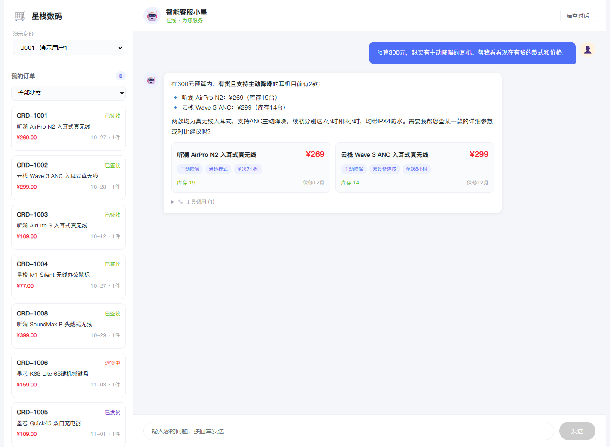
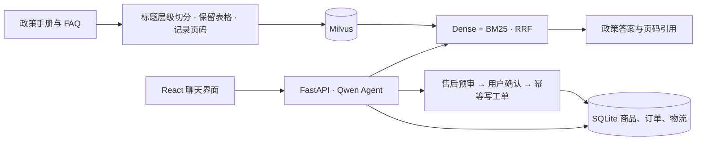

# 星栈数码 · 电商智能客服

基于 LangChain、LangGraph 和 Milvus 的中文电商客服。支持按预算选品、查询订单物流、引用政策原文，以及在用户确认后提交售后工单。



[政策问答](docs/media/policy-fixed.png) · [订单物流](docs/media/shipping.png) · [售后确认](docs/media/after-sales.png) · [人工审核](docs/media/manual-review.png)

## 方法



- **按结构切分 PDF**。短标题和所属正文合并，表格保留为完整证据单元。评测快照从 608 个片段缩减到 262 个。
- **融合语义与关键词检索**。BGE-M3 处理自然语言改写，BM25 补充术语和精确数值匹配，RRF 合并排序。
- **售后由规则服务预审**。校验订单归属和状态，确认后在同一事务中创建工单并更新订单。[架构与确认时序](docs/ARCHITECTURE.md)

## 2×2 消融实验

28 个政策问题，按预期文档 ID 判定相关性。Hit@5 记录每题是否至少命中一个预期文档，Precision@5 和 MRR@5 分别衡量前五条相关比例和首个相关结果的排名。

| 切分策略 | 检索 | 文档命中 @5 | Precision@5 | MRR@5 |
|---|---|---:|---:|---:|
| 旧版 | Dense | 27/28 · 96.43% | 57.86% | 0.875 |
| 层级 + 表格 | Dense | 28/28 · 100% | 75.71% | 0.890 |
| 旧版 | Dense + BM25 + RRF | 27/28 · 96.43% | 60.71% | 0.732 |
| **层级 + 表格** | **Dense + BM25 + RRF** | **28/28 · 100%** | **78.57%** | **0.914** |

新版切分在两种检索方式下都带来约 **17.86 个百分点**的 Precision@5 提升。混合检索在新版切分上把 MRR@5 从 **0.890 提高到 0.914**，在旧版切分上则从 **0.875 降到 0.732**。[评测脚本](ablation_rag.py)

## 本地运行

准备 Python 3.13、Node.js 和支持 BM25 的 Milvus 2.5+。在 PowerShell 中执行：

```powershell
python -m pip install -r requirements.txt
npm.cmd ci --prefix frontend
Copy-Item .env.example .env
```

在 `.env` 中填写 DashScope 和 SiliconFlow API Key，并设置 `MILVUS_URI`。默认聊天模型为 `qwen3.7-plus`，嵌入模型为 `BAAI/bge-m3`。

```powershell
python data/init_sqlite.py
python -c "from backend.rag.ingest import ingest_documents; print(ingest_documents())"
python start.py
```

打开 <http://localhost:5173>。业务记录与知识文档均为合成演示数据。复现实验可运行 `python ablation_rag.py`，脚本使用四个独立的消融集合和随仓库提供的切分快照。
