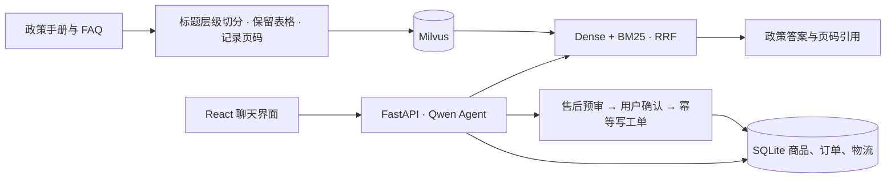

# 星栈数码 · 电商智能客服

星栈数码把电商客服的三类任务放进同一个对话：**查实时业务数据、解释店铺政策、办理需要确认的售后**。用户可以接着上一轮结果缩小选品范围，也可以从查看物流直接进入退货预审。商品价格和库存来自 SQLite，政策回复可追溯到 PDF 原页，售后确认由规则服务执行。

## 看客服如何处理一件事

### 追加预算，重新筛选在售商品

用户先问 300 元以内的主动降噪耳机，随后把预算改为 280 元。客服承接品类和降噪条件，重新查询现货，第一轮展示 269 元和 299 元两款，第二轮只留下 269 元的现货。


### 从物流查询走到售后工单

用户先核对订单物流，再申请退货。系统按订单数据给出预审结果，用户确认后返回工单号，订单侧栏同步从「已签收」更新为「退货中」。


[查看提交前的确认弹窗](docs/media/confirm-dialogue.png)

### 区分无理由退货与质量售后

用户先询问拆封耳机能否无理由退货，再追问超过普通退货时限能否报修。两轮回答分别引用公开 FAQ 第 3 页和第 6 页，指出拆封需人工核验，质量问题与保修按相应政策处理。

<details>
<summary>展开两轮政策对话</summary>


</details>

## 核心方法：把店铺政策变成可检索、可追溯的证据

客服需要同时处理自然语言问法和精确的业务条件。用户可能只说“耳机拆了还能退吗”，答案却取决于商品类别、包装状态和售后类型。PDF 中的孤立标题或表头即使命中，也无法单独解释这些条件。我们从**切分时保留规则上下文**和**检索时结合语义与关键词**两处改进。

### 1. 按标题层级切分，整表保留

解析 PDF 时，根据编号、字号和版面信息识别标题，按章节归并正文，超长章节再递归拆分。遇到连续的多列行时，按版面位置恢复表格并将表头与数据行一起入库。每段保留章节、来源和页码，方便用户核对政策原文。[PDF 解析与切分](backend/rag/pdf_parse.py)

例如，单独的“处理方式”表头无法告诉用户应走哪条售后路径。表头、适用条件和处理方式留在同一段，检索结果才能保留它们的对应关系。新版切分把评测快照从 **608 段缩减到 262 段**。固定检索方式，前五条结果的平均相关比例在 Dense 和混合检索下均提高约 **17.86 个百分点**。

### 2. 两路召回，按排名融合

同一问题进入两条检索路径。**BGE-M3 Dense** 用语义相似度匹配口语化问法，**Milvus BM25** 为政策术语和精确数字提供另一条召回路径。两路先筛选顾客可见资料，再分别取候选，最后由 **RRF** 按各自排名合并，输出带来源元数据的 Top-5。[混合检索实现](backend/rag/ingest.py)

例如，“快递好几天没更新”侧重语义，“72 小时”侧重精确词项。采用新版切分后，加入混合检索将 **Precision@5 从 75.71% 提到 78.57%**，将 **MRR@5 从 0.890 提到 0.914**。旧版切分上 MRR 反而下降，说明在本次评测中，混合检索的排序收益取决于如何组织候选片段。

<details>
<summary>查看完整的 2×2 消融结果与复现方式</summary>

在同一批 **28 个政策问题**上对照切分与检索方式。按预期文档 ID 判定相关性。文档命中 @5 表示前五条是否至少命中一份预期文档。

| 切分策略 | 检索 | 文档命中 @5 | Precision@5 | MRR@5 |
|---|---|---:|---:|---:|
| 旧版 | Dense | 27/28 · 96.43% | 57.86% | 0.875 |
| 层级 + 表格 | Dense | 28/28 · 100% | 75.71% | 0.890 |
| 旧版 | Dense + BM25 + RRF | 27/28 · 96.43% | 60.71% | 0.732 |
| **层级 + 表格** | **Dense + BM25 + RRF** | **28/28 · 100%** | **78.57%** | **0.914** |

完整配置相较旧版切分 + Dense，Precision@5 提升 **20.71 个百分点**，MRR@5 提升 **0.039**。运行 `python ablation_rag.py` 可使用仓库内两套切分快照复现。[评测脚本](ablation_rag.py)

</details>

## 从检索到业务办理



政策回复附来源页码。商品、订单和物流查询读取 SQLite。售后由规则服务检查订单归属、签收时间和商品状态，用户确认后才在同一事务中创建工单并更新订单。相同请求重复确认时返回原工单。[系统架构与确认时序](docs/ARCHITECTURE.md)

## 本地运行

准备 Python 3.13、Node.js 和支持 BM25 的 Milvus 2.5+。在 PowerShell 中执行：

```powershell
python -m pip install -r requirements.txt
npm.cmd ci --prefix frontend
Copy-Item .env.example .env
```

在 `.env` 中填写 DashScope 和 SiliconFlow API Key，并设置 `MILVUS_URI`。默认聊天模型为 `qwen3.7-plus`，嵌入模型为 `BAAI/bge-m3`。

```powershell
python data/init_sqlite.py
python -c "from backend.rag.ingest import ingest_documents; print(ingest_documents())"
python start.py
```

打开 <http://localhost:5173>。业务记录与知识文档均为合成演示数据。复现实验可运行 `python ablation_rag.py`，脚本使用四个独立的消融集合和随仓库提供的切分快照。
