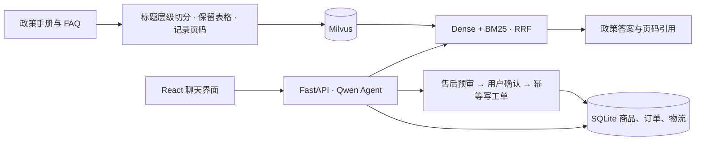

# 星栈数码 · 电商智能客服

星栈数码把电商客服的三类任务放进同一个对话：**查实时业务数据、解释店铺政策、办理需要确认的售后**。用户可以接着上一轮结果缩小选品范围，也可以从查看物流直接进入退货预审。商品价格和库存来自 SQLite，政策回复可追溯到 PDF 原页，售后确认由规则服务执行。

## 看客服如何处理一件事

### 追加预算，重新筛选在售商品

用户先问 300 元以内的主动降噪耳机，随后把预算改为 280 元。客服承接品类和降噪条件，重新查询现货，第一轮展示 269 元和 299 元两款，第二轮只留下 269 元的现货。


### 从物流查询走到售后工单

用户先核对订单物流，再申请退货。系统按订单数据给出预审结果，用户确认后返回工单号，订单侧栏同步从「已签收」更新为「退货中」。


[查看提交前的确认弹窗](docs/media/confirm-dialogue.png)

### 区分无理由退货与质量售后

用户先询问拆封耳机能否无理由退货，再追问超过普通退货时限能否报修。两轮回答分别引用公开 FAQ 第 3 页和第 6 页，指出拆封需人工核验，质量问题与保修按相应政策处理。

<details>
<summary>展开两轮政策对话</summary>


</details>

## 系统怎么做判断



- **政策检索保留条款上下文。** 短标题与正文合并，表格作为完整证据单元，片段保留页码。切分后的评测快照由 608 段收敛到 262 段。
- **语义与关键词共同参与排序。** BGE-M3 处理自然语言改写，BM25 补充术语和精确数值匹配，再用 RRF 融合。公开 FAQ 可直接返回已匹配的标准答复及对应页码。
- **模型理解请求，规则服务处理售后。** 系统按归属、签收时间和商品状态预审。用户确认后，在同一事务中创建工单并更新订单，重复提交返回同一工单。[架构与确认时序](docs/ARCHITECTURE.md)

## 2×2 消融实验

28 个政策问题，按预期文档 ID 判定相关性。Hit@5 记录每题是否至少命中一个预期文档，Precision@5 和 MRR@5 分别衡量前五条相关比例和首个相关结果的排名。

| 切分策略 | 检索 | 文档命中 @5 | Precision@5 | MRR@5 |
|---|---|---:|---:|---:|
| 旧版 | Dense | 27/28 · 96.43% | 57.86% | 0.875 |
| 层级 + 表格 | Dense | 28/28 · 100% | 75.71% | 0.890 |
| 旧版 | Dense + BM25 + RRF | 27/28 · 96.43% | 60.71% | 0.732 |
| **层级 + 表格** | **Dense + BM25 + RRF** | **28/28 · 100%** | **78.57%** | **0.914** |

新版切分在两种检索方式下都带来约 **17.86 个百分点**的 Precision@5 提升。混合检索在新版切分上把 MRR@5 从 **0.890 提高到 0.914**，在旧版切分上则从 **0.875 降到 0.732**。[评测脚本](ablation_rag.py)

## 本地运行

准备 Python 3.13、Node.js 和支持 BM25 的 Milvus 2.5+。在 PowerShell 中执行：

```powershell
python -m pip install -r requirements.txt
npm.cmd ci --prefix frontend
Copy-Item .env.example .env
```

在 `.env` 中填写 DashScope 和 SiliconFlow API Key，并设置 `MILVUS_URI`。默认聊天模型为 `qwen3.7-plus`，嵌入模型为 `BAAI/bge-m3`。

```powershell
python data/init_sqlite.py
python -c "from backend.rag.ingest import ingest_documents; print(ingest_documents())"
python start.py
```

打开 <http://localhost:5173>。业务记录与知识文档均为合成演示数据。复现实验可运行 `python ablation_rag.py`，脚本使用四个独立的消融集合和随仓库提供的切分快照。
