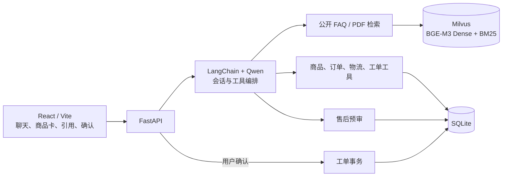
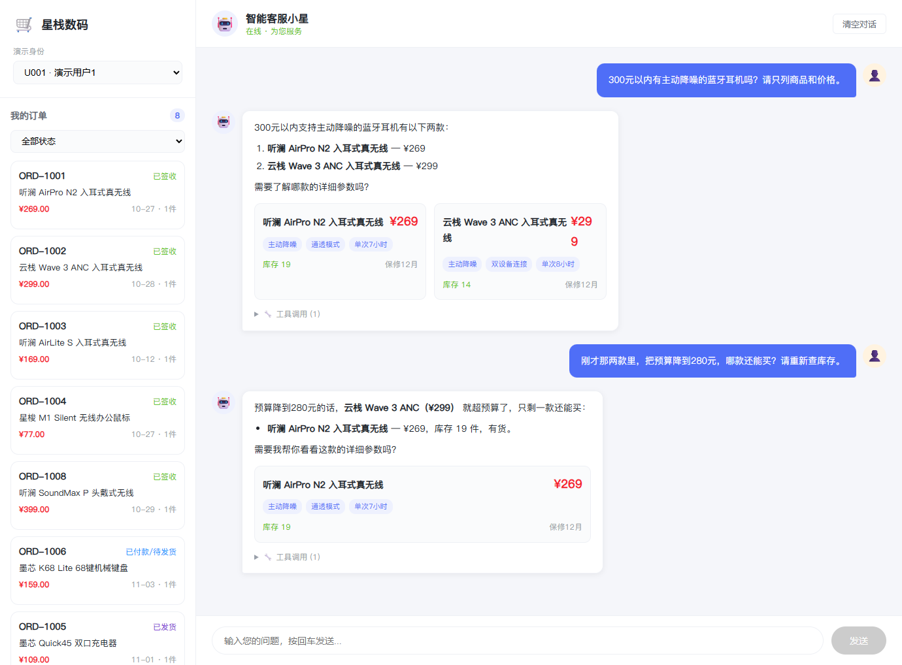
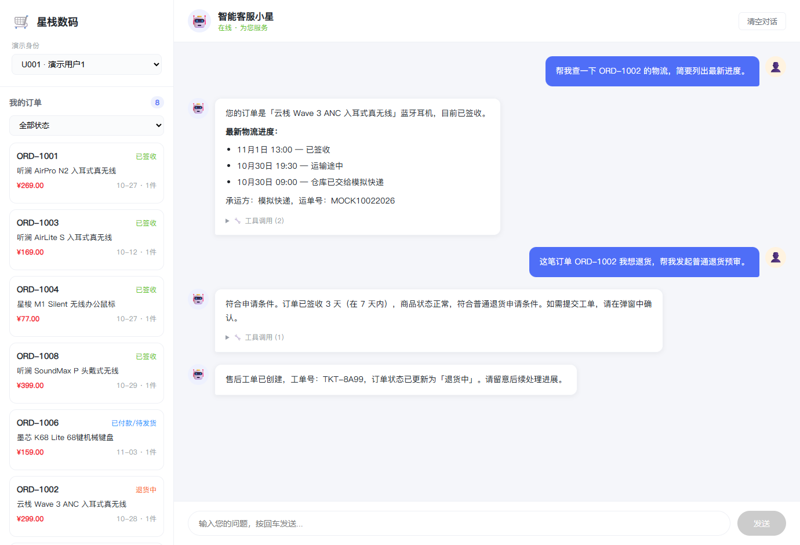
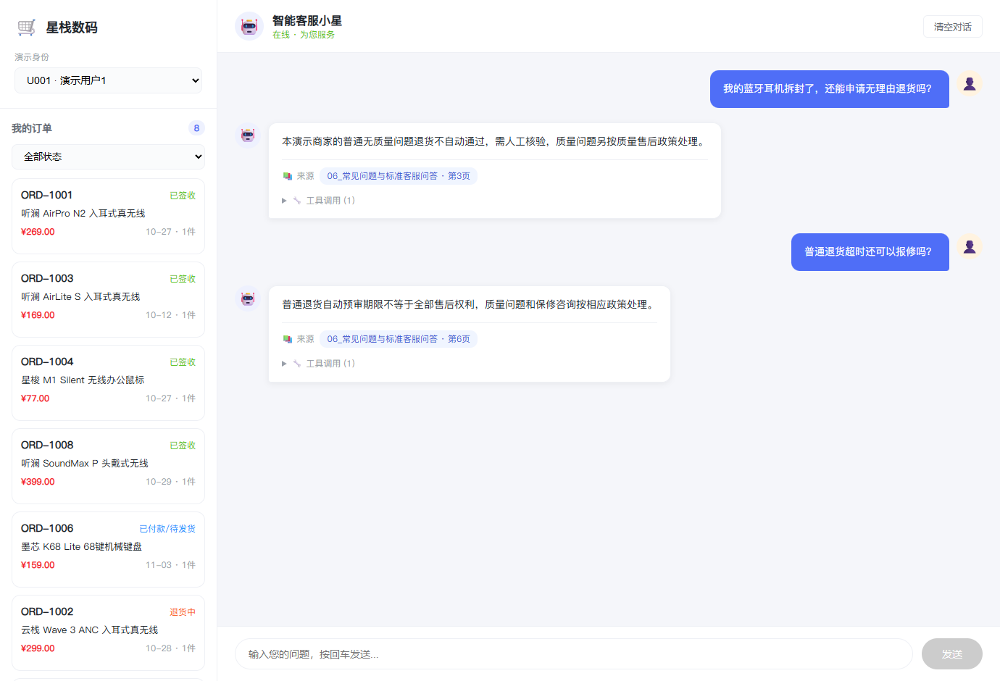

# 星栈数码 · 电商智能客服

一个从**查商品、答政策到办售后**的中文客服 Agent。用户可以追加预算继续选品，追问政策时查看原文页码，也可以在查完物流后发起退货预审，并在确认后收到工单号。

[主要能力](#主要能力) · [项目架构](#项目架构) · [多轮演示](#多轮演示) · [本地运行](#本地运行)

## 主要能力

| 场景 | 用户可以做什么 | 系统如何处理 |
| --- | --- | --- |
| 商品选购 | 按预算、品类与功能筛选现货，追加条件或比较指定型号 | 查询 SQLite 商品规格、价格与库存，返回商品卡 |
| 政策与使用咨询 | 询问退换货、保修、物流规则与设备使用 | 匹配公开 FAQ 或检索 PDF 手册，返回来源与页码 |
| 订单与物流 | 查看自己的订单、商品明细和配送轨迹 | 服务端绑定当前演示用户，校验订单归属后查询 |
| 售后申请 | 预审退货、换货或质量问题，确认提交并查看工单 | 规则服务判断资格或转人工审核，确认后事务写入 |
| 多轮对话 | 用“刚才那两款”继续缩小预算，或从查询订单接着申请售后 | 按用户和会话保存上下文，需要业务事实时调用工具查询 |

## 项目架构



**会话负责理解，工具负责取证，服务负责执行。** Qwen 根据问题与上下文选择工具。业务服务检查订单归属和售后状态，前端用独立确认请求提交草稿。政策证据走 Milvus，动态业务数据走 SQLite。[模块职责、接口与售后时序](docs/ARCHITECTURE.md)

## 核心方法：把店铺政策变成可检索、可追溯的证据

客服需要同时处理自然语言问法和精确的业务条件。用户可能只说“耳机拆了还能退吗”，答案却取决于商品类别、包装状态和售后类型。PDF 中的孤立标题或表头即使命中，也无法单独解释这些条件。我们从**切分时保留规则上下文**和**检索时结合语义与关键词**两处改进。

### 1. 按标题层级切分，整表保留

基础切分以页面为单位，短标题会独立成块。

解析 PDF 时，根据编号、字号和版面信息识别标题，按章节归并正文，超长章节再递归拆分。遇到连续的多列行时，按版面位置恢复表格并将表头与数据行一起入库。每段保留章节、来源和页码，方便用户核对政策原文。[PDF 解析与切分](backend/rag/pdf_parse.py)

例如，单独的“处理方式”表头无法告诉用户应走哪条售后路径。表头、适用条件和处理方式留在同一段，检索结果才能保留它们的对应关系。固定检索方式，前五条结果的平均相关比例在 Dense 和混合检索下均提高约 **17.86 个百分点**。

### 2. 两路召回，按排名融合

同一问题进入两条检索路径。**BGE-M3 Dense** 用语义相似度匹配口语化问法，**Milvus BM25** 为政策术语和精确数字提供另一条召回路径。两路先筛选顾客可见资料，再分别取候选，最后由 **RRF** 按各自排名合并，输出带来源元数据的 Top-5。[混合检索实现](backend/rag/ingest.py)

例如，“快递好几天没更新”侧重语义，“72 小时”侧重精确词项。采用新版切分后，加入混合检索将 **Precision@5 从 75.71% 提到 78.57%**，将 **MRR@5 从 0.890 提到 0.914**。基础切分上 MRR 反而下降，说明在本次评测中，混合检索的排序收益取决于如何组织候选片段。

### 评测与复现

在同一批 **28 个政策问题**上对照切分与检索方式。按预期文档 ID 判定相关性。文档命中 @5 表示前五条是否至少命中一份预期文档。

| 切分策略 | 检索策略 | 文档命中 @5 | Precision@5 | MRR@5 |
|---|---|---:|---:|---:|
| 基础 | Dense | 27/28 · 96.43% | 57.86% | 0.875 |
| 层级 + 表格 | Dense | 28/28 · 100% | 75.71% | 0.890 |
| 基础 | Dense + BM25 + RRF | 27/28 · 96.43% | 60.71% | 0.732 |
| **层级 + 表格** | **Dense + BM25 + RRF** | **28/28 · 100%** | **78.57%** | **0.914** |

完整配置相较基础切分 + Dense，Precision@5 提升 **20.71 个百分点**，MRR@5 提升 **0.039**。

## 多轮演示

### 追加预算，重新筛选在售商品

用户先问 300 元以内的主动降噪耳机，随后把预算改为 280 元。客服承接品类和降噪条件，重新查询现货，第一轮展示 269 元和 299 元两款，第二轮只留下 269 元的现货。



### 从物流查询走到售后工单

用户先核对订单物流，再申请退货。系统按订单数据给出预审结果，用户确认后返回工单号，订单侧栏同步从「已签收」更新为「退货中」。



[查看提交前的确认弹窗](docs/media/confirm-dialogue.png)

### 区分无理由退货与质量售后

用户先询问拆封耳机能否无理由退货，再追问超过普通退货时限能否报修。两轮回答分别引用公开 FAQ 第 3 页和第 6 页，指出拆封需人工核验，质量问题与保修按相应政策处理。



## 本地运行

准备 Python 3.13、Node.js 和支持 BM25 的 Milvus 2.5+。在 PowerShell 中执行：

```powershell
python -m pip install -r requirements.txt
npm.cmd ci --prefix frontend
Copy-Item .env.example .env
```

在 `.env` 中填写 DashScope 和 SiliconFlow API Key，并设置 `MILVUS_URI`。默认聊天模型为 `qwen3.7-plus`，嵌入模型为 `BAAI/bge-m3`。

```powershell
python data/init_sqlite.py
python -c "from backend.rag.ingest import ingest_documents; print(ingest_documents())"
python start.py
```

打开 <http://localhost:5173>。业务记录与知识文档均为合成演示数据。复现实验可运行 `python ablation_rag.py`，脚本使用四个独立的消融集合和随仓库提供的切分快照。

## 项目结构

```text
.
├── backend/
│   ├── main.py                     # FastAPI 接口与健康检查
│   ├── config.py                   # 模型、数据库与知识库配置
│   ├── schemas.py                  # API 请求与响应结构
│   ├── agent/
│   │   ├── chat.py                 # 多轮上下文、工具调用与回复组织
│   │   ├── factory.py              # 聊天模型与嵌入模型
│   │   ├── tools.py                # 商品、政策、订单与售后工具
│   │   └── after_sales_graph.py    # LangGraph 预审入口与待确认草稿
│   ├── rag/
│   │   ├── pdf_parse.py            # 标题层级切分与表格恢复
│   │   ├── ingest.py               # Milvus 入库、双路召回与 RRF 融合
│   │   └── retrieve.py             # 证据片段与来源元数据
│   ├── services/
│   │   ├── products.py            # 商品筛选与型号查询
│   │   ├── orders.py              # 订单归属、物流与工单查询
│   │   └── after_sales.py         # 资格判断与工单写入
│   └── storage/
│       └── sqlite.py              # SQLite 连接、查询与事务
├── frontend/
│   └── src/
│       ├── App.jsx                # 聊天、订单侧栏、引用与确认弹窗
│       └── api.js                 # 前端接口封装
├── data/
│   ├── business/                  # 商品、订单、物流与售后种子数据
│   ├── knowledge/                 # PDF 手册与知识库清单
│   ├── eval/                      # 评测样例与切分快照
│   └── init_sqlite.py             # 初始化业务数据库
├── docs/
│   ├── ARCHITECTURE.md            # 模块职责、接口与售后时序
│   └── media/                     # 多轮演示截图
└── start.py                        # 本地启动入口
```
