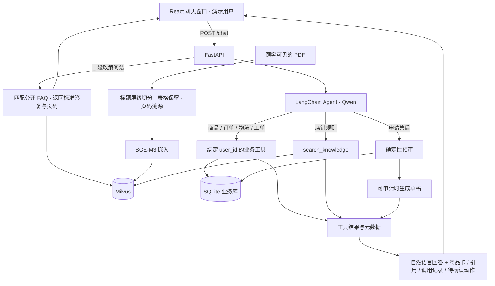
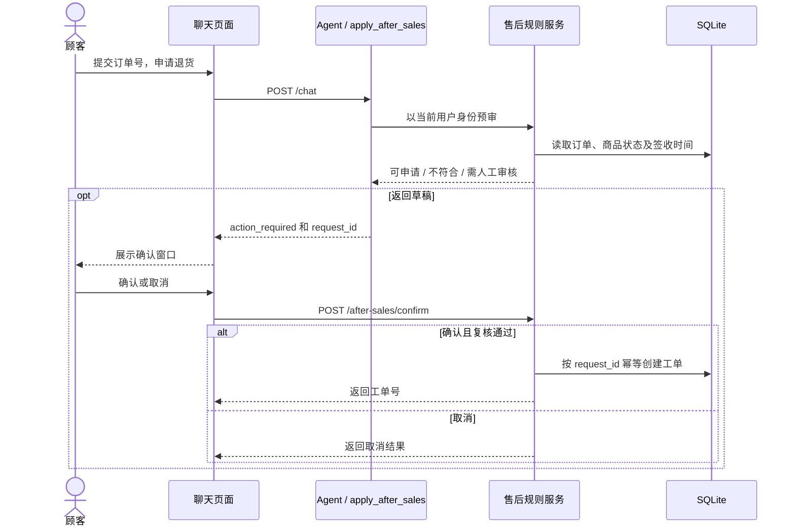

# 系统架构

## 一次对话的数据流

政策查询先匹配公开 FAQ，手册查询通过 Dense + BM25 召回并由 RRF 合并。业务工具从当前演示用户上下文读取商品、订单和物流。

## 售后何时产生写操作

聊天工具直接调用预审服务。独立的 `/after-sales/preview` 入口通过 LangGraph 的 preview 节点调用同一服务。待确认草稿保存在进程内，服务重启后尚未提交的申请需要重新预审。已写入的工单可以按用户和请求号从业务库查回。

[聊天编排](../backend/agent/chat.py) · [工具定义](../backend/agent/tools.py) · [售后流程](../backend/agent/after_sales_graph.py) · [规则与写入](../backend/services/after_sales.py)
